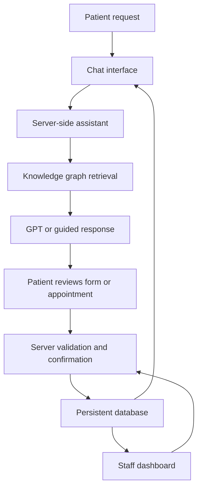

# Medora — AI-Assisted Hospital Administration

Medora is an academic web application that helps patients prepare registration forms, find doctors, and manage appointments. It combines a conversational interface, structured hospital records, and a knowledge graph to support administrative tasks.

The project includes a **patient portal**, a **staff dashboard**, and a **server-side API with persistent storage**.

> **Prototype status:** The current application uses fictional hospital data. Graph-backed guided chat is available. Live GPT responses require a server-side OpenAI API key. The prototype does not provide medical diagnosis or treatment advice.

## Demo

The hosted demo is private and requires an authorized ChatGPT account. Adding this link to a public GitHub repository does not make the demo publicly accessible.

## Project Objective

Hospital registration and appointment processes often involve repeated questions, incomplete forms, and information spread across different systems. Medora brings these administrative tasks into one website.

The project investigates the following research question:

> Can combining conversational understanding with structured hospital information provide more reliable administrative assistance than a standalone chatbot?

The proposed research method combines a literature review with prototype evaluation. Comparative model results have not yet been collected.

## Key Features

### Patient Portal

- Create and edit a patient registration profile.
- Validate required details and request consent before saving.
- Prepare a checklist of identification, insurance, referral, and guardian documents.
- Search fictional doctors and filter by department.
- View available appointment slots for the next 14 days.
- Review and confirm appointment details before booking.
- Reschedule or cancel confirmed appointments.
- Download appointment summaries in JSON format.
- Ask the assistant about registration, documents, departments, and appointments.
- Use English or Thai patient navigation and administrative responses.

### Staff Dashboard

- View registration and appointment summaries.
- Review patient registrations and record administrative notes.
- Mark registrations as pending, reviewed, or requiring changes.
- Manage doctor details and availability.
- Close or reopen appointment slots.
- Check in patients and mark visits as completed.
- Create and edit knowledge graph entities and relationships.
- Review server activity and export structured information.

### Server Features

- Server-side input validation using Zod.
- Persistent patient, doctor, appointment, and graph records.
- Account-scoped queries to isolate each owner's demo workspace.
- A database uniqueness constraint to prevent duplicate active bookings.
- Atomic rescheduling that preserves the original booking if the new slot conflicts.
- Server-side GPT integration with a labelled guided fallback.
- Audit records for administrative changes.

## Technology Stack

| Layer | Current implementation |
| --- | --- |
| Frontend | React, TypeScript, CSS, Lucide icons |
| Application framework | Vinext with Vite |
| Backend | TypeScript API routes on Cloudflare Workers |
| Database | Cloudflare D1, a managed SQLite database |
| Schema and migrations | Drizzle ORM tooling and SQL migrations |
| Validation | Zod |
| Knowledge graph | Persistent node and edge tables with two-hop retrieval |
| LLM integration | OpenAI API; default configured model: `gpt-4.1-mini` |
| Hosted authentication | Sign in with ChatGPT |

**Architecture note:** Python/FastAPI, PostgreSQL, and Neo4j were discussed in the original proposal. The current hosted prototype uses TypeScript and D1 instead. A migration to those services is future work; they are not dependencies of this version.

## System Workflow




1. The patient describes an administrative need in the chatbot or opens a form directly.
2. The assistant retrieves relevant graph facts and can extract basic registration fields from the message.
3. If GPT is configured, the server sends the conversation and selected graph context to the model. Otherwise, guided responses remain available.
4. The patient opens the appropriate screen and reviews the details.
5. The server validates the request and saves the confirmed action.
6. The saved registration or appointment becomes available in the staff view.

The chatbot does not directly create, change, or cancel appointments. These actions require confirmation through the application.

## Knowledge Graph

The graph connects administrative entities such as:

| Entity | Example |
| --- | --- |
| Doctor | A fictional doctor assigned to a department |
| Department | Dental Care |
| Service | Dental consultation |
| Form | Patient registration |
| Document | Photo ID or passport |
| Location | A department's floor and wing |
| Policy | Opening hours |

Supported relationships include `WORKS_IN`, `PROVIDES`, `REQUIRES`, `MAY_REQUIRE`, `LOCATED_AT`, and `RELATED_TO`.

For example, a doctor **works in** Dental Care, which **provides** a consultation service. That service **requires** registration, and registration **requires** identification.

Retrieval follows connected relationships for up to two hops and supplies relevant facts to the assistant. The current implementation uses D1 tables, not a separate Neo4j server.

## Dataset

The current version seeds **15 fictional doctors across five departments**:

- General Medicine
- Dental Care
- Dermatology
- Cardiology
- Pediatrics

It also includes fictional fees, locations, administrative policies, document requirements, and graph relationships. Patient profiles and appointments are created during testing.


**No Kaggle dataset or real patient dataset is currently included.** If an external dataset is added for the assignment, document its source URL, license, selected fields, cleaning steps, and any anonymization. Synthetic appointment and registration examples should remain clearly labelled.

## Project Structure

| Path | Purpose |
| --- | --- |
| `app/page.tsx` | Patient portal, staff dashboard, and chat interface |
| `app/globals.css` | Application styling and responsive layout |
| `app/api/medora/route.ts` | API actions, validation, and authorization checks |
| `app/chatgpt-auth.ts` | Hosted identity handling |
| `lib/domain.ts` | Shared validation, time slots, graph search, and field extraction |
| `lib/server.ts` | Database operations, demo seeding, and chatbot integration |
| `db/schema.ts` | Database schema |
| `drizzle/` | SQL migrations |
| `worker/index.ts` | Worker entry point |
| `tests/` | API/database integration tests and test adapters |
| `.env.example` | Optional environment variable names without credentials |

## Getting Started

These instructions apply to the generated Medora source project. A README alone does not contain the application code.

### Prerequisites

- Node.js 24 recommended; the application requires Node.js 22.13 or newer.
- The pnpm version specified in `package.json`.
- The complete application source, including migrations and runtime scripts.
- A Cloudflare Workers/D1-compatible environment for the current backend.
- An OpenAI API key only if live GPT responses are needed.

### Install dependencies

From the repository root:

```bash
pnpm install
```

### Run checks

```bash
node node_modules/typescript/bin/tsc --noEmit
pnpm test
```

### Build

```bash
pnpm build
```

### Initialize the local database

After the build generates the Worker configuration, apply the included migration:

```bash
node --import ./scripts/sites-env.mjs ./node_modules/wrangler/bin/wrangler.js d1 execute DB --local --config dist/server/wrangler.json --persist-to .wrangler/state --file drizzle/0000_amusing_blacklash.sql
```

### Start the local built application

```bash
pnpm start
```

Use the local address printed by the runtime.

**Local authentication limitation:** The hosted version receives trusted identity headers from its authentication gateway. A normal local browser session does not receive those headers, so authenticated data requests will return `401` until local authentication is deliberately configured. The application does not include an authentication bypass. Automated integration tests use synthetic identities in a separate test harness.

